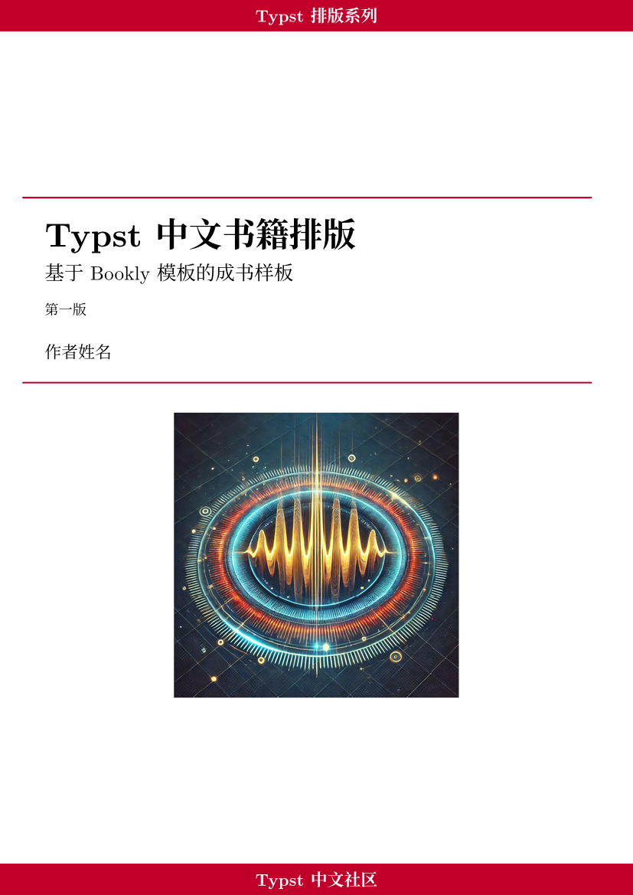
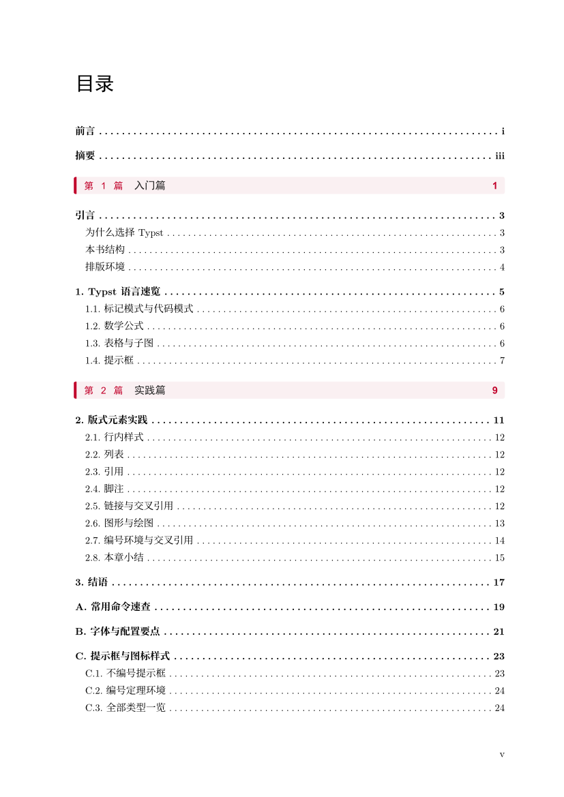
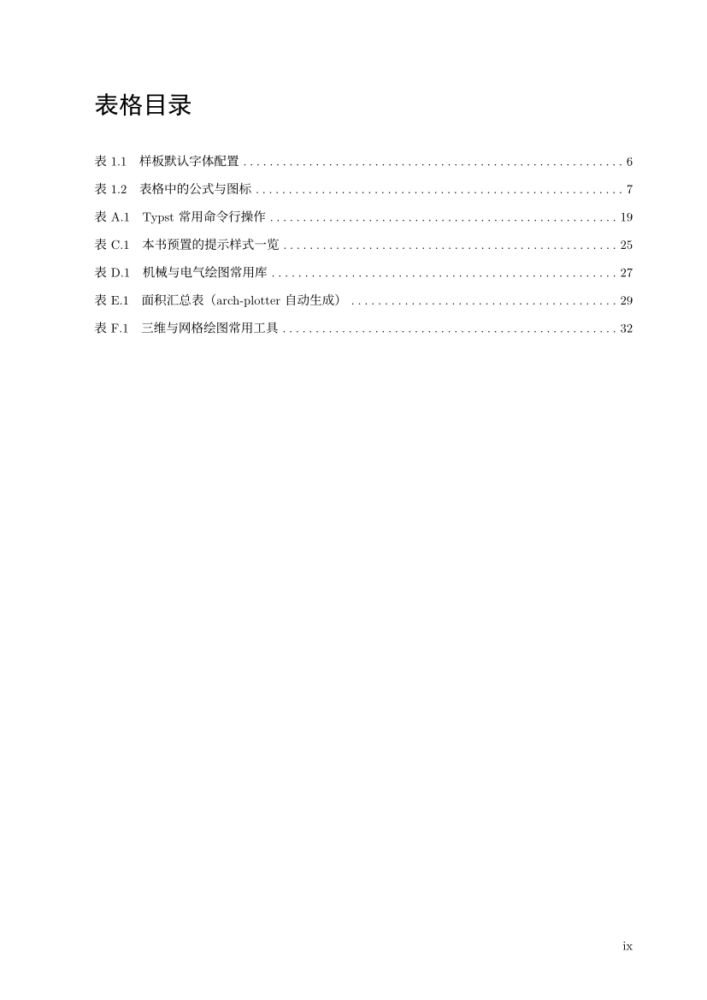
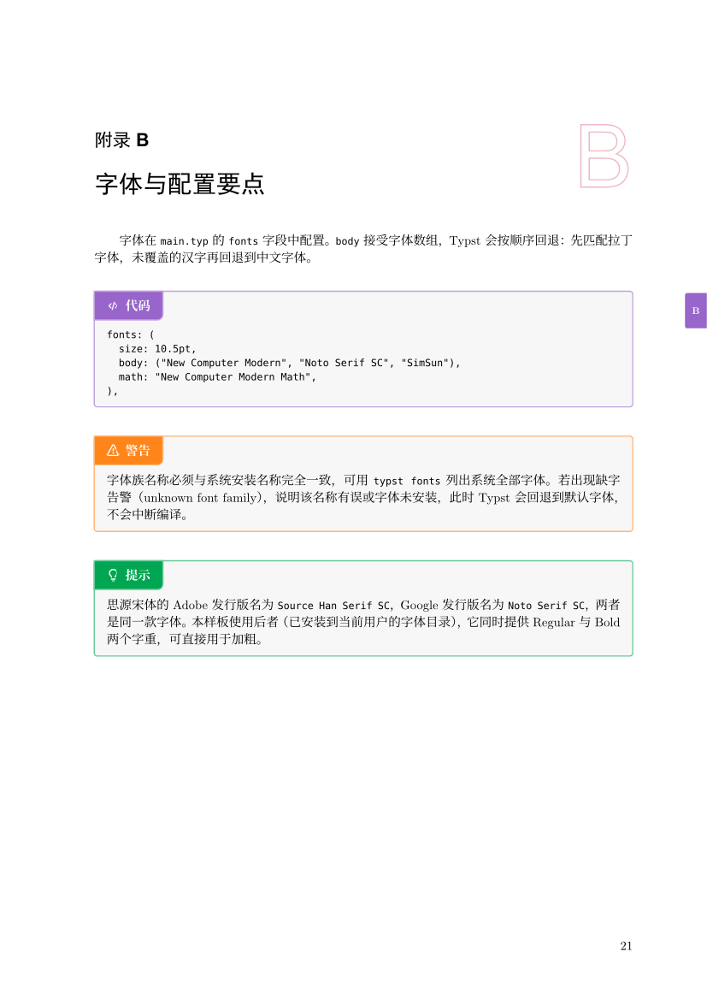

# typst-book-author

一个 Agent Skills 技能：用基于 [Bookly](https://typst.app/universe/package/bookly) 5.1.1
调校的 Typst 中文书籍样板排书。封面/版权页、目录（含「篇」行与图表目录）、
篇章页、切口色标、书眉、提示框与定理环境、图表公式、GB/T 7714 参考文献、
附录与封底开箱即用。内置六个主题色（朱砂、靛蓝、松绿、赭石、紫棠、石墨），
`colors.typ` 一行切换，全书签名色自动同步。

## 效果预览

| 封面 | 目录（篇行色条） |
| :---: | :---: |
|  |  |

| 篇章页（空心篇次数字 + 本篇小目录） | 正文（提示框 + 切口色标） |
| :---: | :---: |
|  |  |

## 目录结构

```
typst-book-author/
├── SKILL.md               技能入口：工作流程与文件一览
├── README.md              本文件
├── preview/               效果预览图
├── references/            按需阅读的参考文档
│   ├── design.md          版式架构与设计意图（改模块前读）
│   ├── customization.md   常见定制任务（换色/开本/边距/扩框型…）
│   └── pitfalls.md        踩坑记录（不收敛/标题消失/字体异常…）
├── scripts/               技能侧工具（不进书稿项目）
│   ├── scaffold.py        复制模板建新书，顺手写书名/作者/主题
│   ├── doctor.py          旧拷贝体检（模板版本与已修规则）
│   ├── test_doctor.py     体检规则自检
│   └── blankpages.py      找空白衬页、核对切口色标清单（定稿前跑，--check 可进 CI）
└── template/              完整可编译的书籍样板
    ├── main.typ           入口：元数据、字体、目录规则、篇章结构
    ├── colors.typ         主题切换（六主题）与全书配色唯一来源
    ├── boxes.typ          提示框 / 定理环境 / 加框公式
    ├── figstyle.typ       CeTZ / Fletcher / Lilaq 统一图形样式
    ├── code-theme.tmTheme 代码块语法高亮主题（色值与调色板同源）
    ├── partpage.typ       篇章页与目录「篇」行
    ├── chaptermark.typ    章首页装饰章号、装订边距
    ├── runninghead.typ    书眉
    ├── pagetabs.typ       切口色标（拇指索引）
    ├── front_matter/  chapters/  appendix/   内容示例（即用法文档）
    └── bibliography/  images/  data/         文献库与素材
```

## 安装

把本文件夹放进技能目录即可，支持 [Agent Skills](https://agentskills.io) 规范的工具会自动发现：

```
~/.agents/skills/typst-book-author/     # 个人技能（所有项目可用）
<项目>/.agents/skills/typst-book-author/  # 仅当前项目
```

在 DeepSeek Harness 里，`~/.dsh/skills/` 也是个人技能目录，而且优先级更高
（`user-dsh` 400 > `user-agents` 500）：两处各放一份时只有 `~/.dsh/` 那份生效，
另一份静默失效。装一次、只装一处即可。

`typst-note-author` 与 `typst-book-author` 请装在**同一个技能根**下——它带的
`check_sync.py` 按"兄弟目录"找对方，分到两个根里就跑不起来。

## 使用

对支持 Agent Skills 的 AI 编程助手说「帮我把这些笔记排成一本书」「用 Typst 写一本中文教材」之类的话，
技能会自动触发：复制 `template/` 到你的项目、改元数据、替换内容、给出编译命令。

命令行起新书（也可手动 `cp -r template/ mybook/`）：

```bash
python scripts/scaffold.py --to mybook --title "我的书" --author "张三" --theme indigo
cd mybook && typst compile main.typ "我的书.pdf"
```

`--theme` 可选 cinnabar / indigo / pine / ochre / zitan / graphite
（`--list-themes` 随时查）；目标目录非空会拒绝，确认合并加 `--force`。

要求 Typst 0.15+，首次编译需联网拉取 `@preview` 依赖。字体依赖：
思源宋体（Noto Serif SC）、SimHei、KaiTi、New Computer Modern、DejaVu Sans Mono。

## 依赖

- [Bookly](https://typst.app/universe/package/bookly) 5.1.1（书籍骨架）
- [CeTZ](https://typst.app/universe/package/cetz) / [Fletcher](https://typst.app/universe/package/fletcher) /
  [Lilaq](https://typst.app/universe/package/lilaq)（图形）
- [Heroic](https://typst.app/universe/package/heroic)（Heroicons 图标）
- 附录 app4–app6 的工程绘图示例另需 zap、bone、mechanical-system-cetz-34j、
  arch-plotter、maquette、plotsy-3d、vmesh；其中 app4 的 cetz 固定为 0.5.0
  （mechanical-system 按它构建），与 figstyle 的 0.5.2 并存属有意为之，勿合并升级。

## 许可

[MIT](LICENSE)
